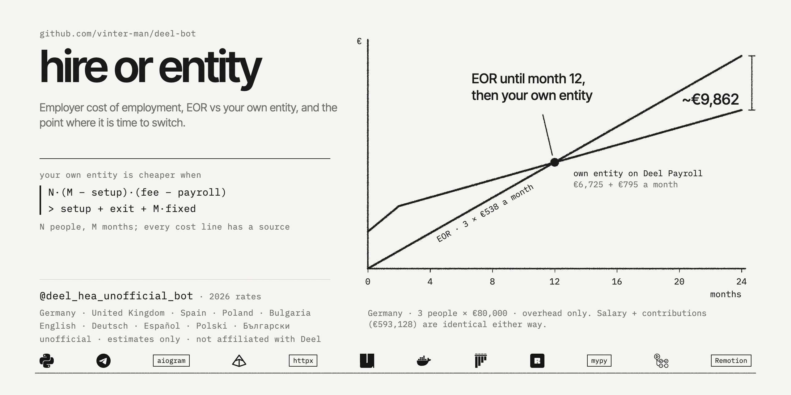
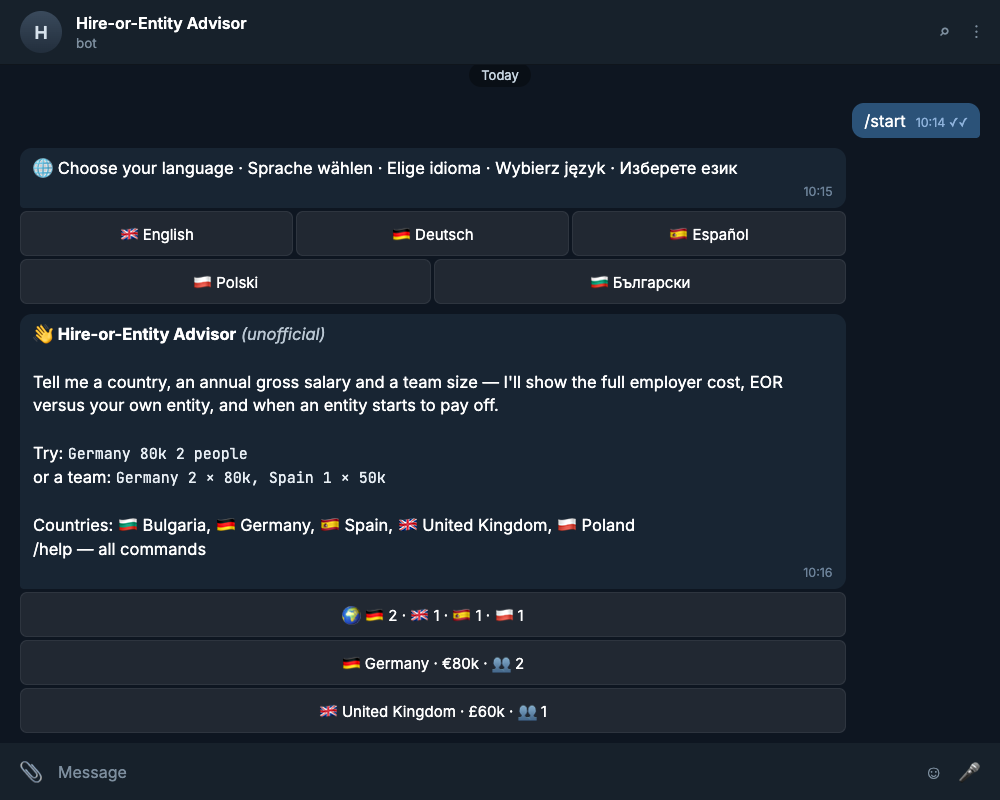
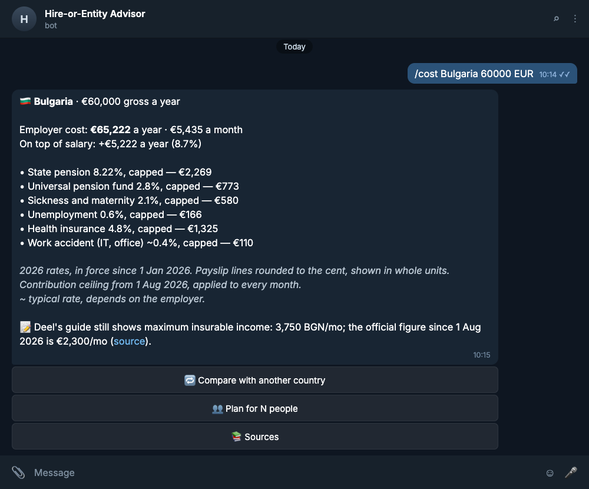
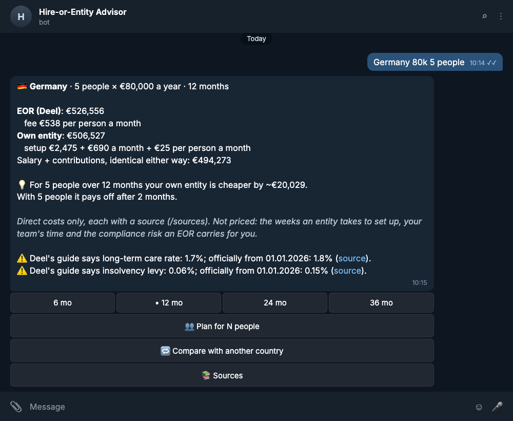
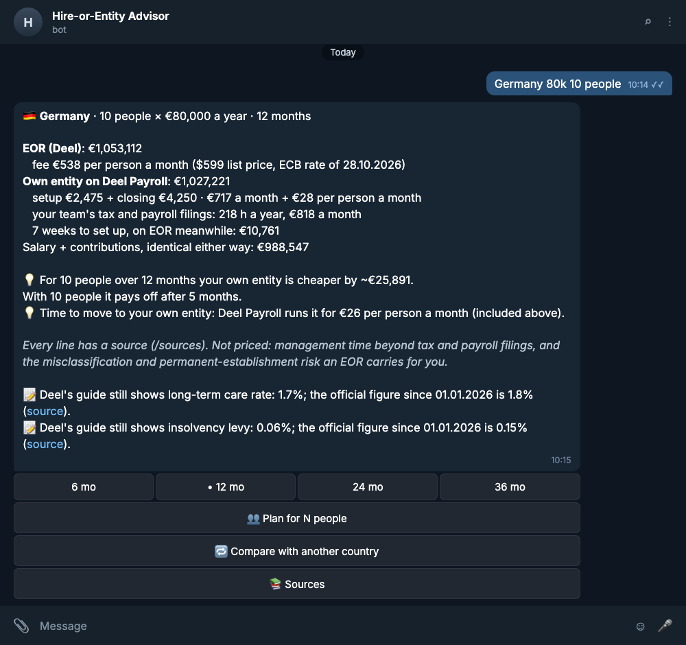
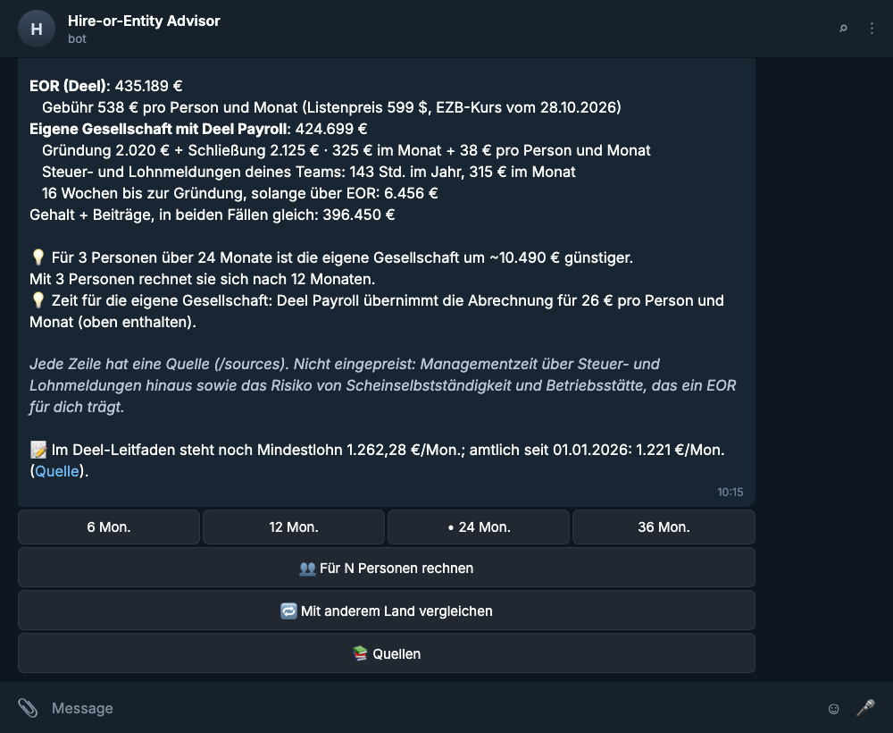
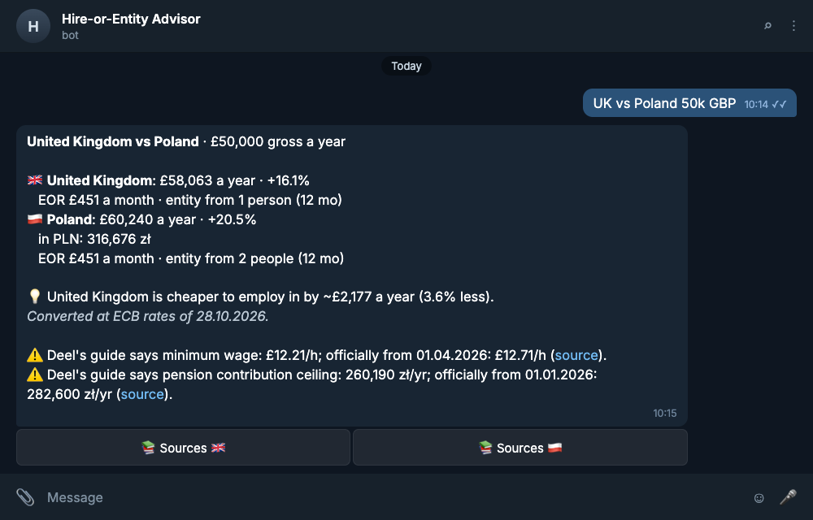
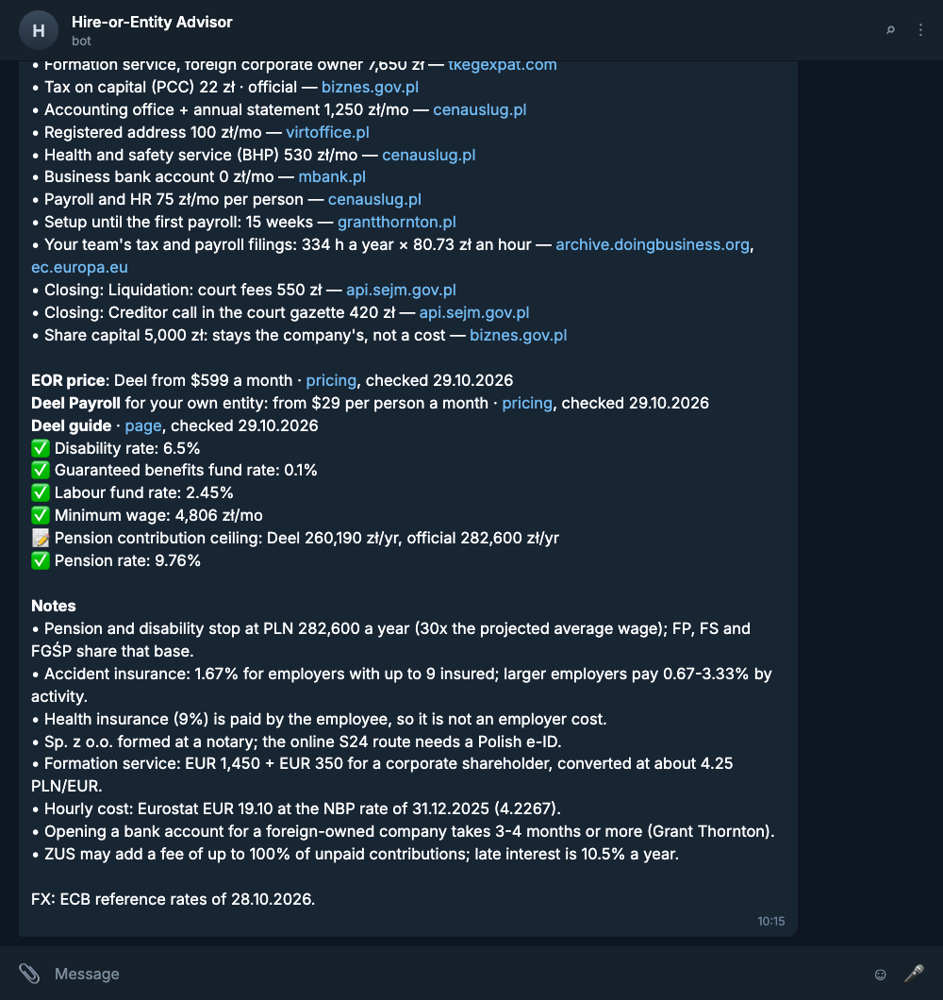
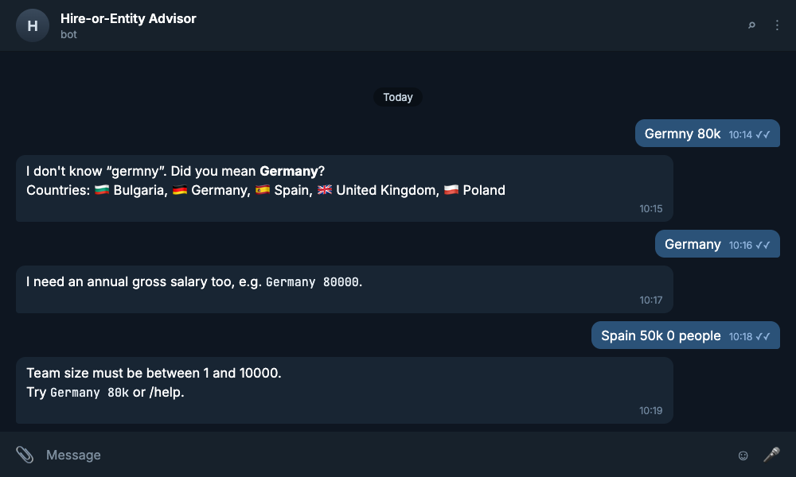

[](https://github.com/vinter-man/deel-bot/actions/workflows/ci.yml)


[](https://t.me/deel_hea_unofficial_bot)
[](LICENSE)



> **Unofficial, estimates only, not legal or tax advice.** Not affiliated with Deel. Every
> figure has a source you can open from the bot with `/sources`.

## Short description

You type a country, an annual gross salary and a team size. The bot answers in a second with
three things:

1. **The full employer cost** — salary plus every employer contribution (pension, health,
   unemployment, accident, the levies nobody remembers), with contribution ceilings applied,
   line by line.
2. **EOR versus your own entity** — Deel's list price per person per month against what a local
   company really costs: setting it up, running it (accountant, address, bank, chamber fees,
   occupational health, the UK audit), the weeks before it can run its first payroll, and closing
   it again. Every line has a source.
3. **The break-even point** — up to which team size the EOR is the cheaper way in, and from which
   one it is time for your own entity, run on Deel Payroll.

And a fourth one I did not plan for: when **Deel's own public country guide** shows a figure
that has since changed, the reply says so — *"Deel's guide still shows 0.06%; the official figure
since 1 Jan 2026 is 0.15% (source)"*. I compared the guides with the official sources by hand and
found six in five countries; a script in the repo re-checks that the quoted figures are still on
Deel's pages.

Try it: [@deel_hea_unofficial_bot](https://t.me/deel_hea_unofficial_bot). It speaks the
languages of the countries it covers — English, German, Spanish, Polish and Bulgarian — and asks
which on the first `/start`.


Germany, United Kingdom, Spain, Poland and Bulgaria, with 2026 rates.

---

## Table of contents

* [User guide](#user-guide)
  * [First steps](#fs)
  * [What it costs to employ someone](#cost)
  * [EOR or your own entity](#plan)
  * [Two countries side by side](#compare)
  * [Where every number comes from](#sources)
  * [When you type something odd](#errors)
* [Commands](#commands)
* [The data](#data)
* [Installation](#installation)
* [Under the hood](#hood)
* [Contact](#contact)

---
---

## <a name="user-guide"></a> User guide

### <a name="fs"></a> First steps

`/start`, pick a language, and tap one of the three examples — or just type.



> :suspect: The bot remembers exactly one thing about you: the language you picked. Not your id
> even — the key is an HMAC of your Telegram id under a secret that never leaves the server, so
> the table cannot be joined back to an account. No names, no queries, no message text in the
> logs; `/stats` (owner only) is a counter per command and nothing else. `prefs.py`.

### <a name="cost"></a> What it costs to employ someone

`/cost Bulgaria 60000 EUR`, or just `Bulgaria 60k`.



Every line is a real payslip line: the annual salary is split into twelve monthly payslips,
each contribution is charged on its own slice of the salary, rounded half-up to the cent, and
the year is twelve of those. Lines marked `~` depend on the employer (accident insurance by
industry, German U1/U2 by health insurer) and carry a typical rate.

> :godmode: One formula covers every country: `rate × max(0, min(salary, cap) − floor)`. A
> plain ceiling is a `cap` (German pension stops at €8,450 a month). A threshold is a `floor`
> (UK employer NIC: 15% above £5,000 a year). Both make a band — the UK workplace pension is 3%
> of earnings between £6,240 and £50,270, and Spain's 2026 solidarity contribution is three
> bands stacked above the €5,101.20 ceiling. Bulgaria's ceiling changed in the middle of the
> year (€2,111.64 → €2,300 from 1 August); the bot prices a hire made today, so it applies the
> ceiling in force now to every month and says so under the breakdown.
>
> All money is `Decimal`. Rates and amounts in the data files are JSON *strings* — the schema
> refuses `0.093` as a number, because by the time Python sees it, it is already
> 0.09299999999999999. Rounding is explicit and half-up, at the payslip line, the way payroll
> does it; the reply shows whole units and says it. `calc.py`, `money.py`.

Write `5000/mo` (or `pro Monat`, `al mes`, `miesięcznie`, `на месец`) for a monthly salary. If the annual figure is below
the country's minimum wage, the reply suggests you probably meant a monthly one.

### <a name="plan"></a> EOR or your own entity

`/plan Germany 80000 2 12` — country, salary, people, months. Or `Germany 80k 2 people`.



Two people in Germany: the EOR is cheaper, and a GmbH starts to pay off at three. Ten people,
and the answer turns — with the next step spelled out:



The buttons switch the horizon (6 / 12 / 24 / 36 months) in place, change the team size, or
compare with another country. The same in German, with the grammar right — *für 3 Personen*,
*nach 2 Monaten* — and in Polish, where a count changes the noun's case: *dla 3 osób*, *po 2
miesiącach*, *przez 24 miesiące*. Numbers follow the language too: `80.000 €`, `9,3 %`.



> :hurtrealbad: Salary and contributions are identical either way — an EOR invoices them
> through — so they are shown once and cancel out. What is compared is everything else:
>
> | Entity side | Where the number comes from |
> |---|---|
> | setup: registration, notary, formation for a foreign owner | official fee schedules, law-firm price pages |
> | running: accountant, address, bank, chamber fees, occupational health | official fees, provider price pages |
> | the UK statutory audit, required unless the whole group is small | a UK audit firm's published starting fee |
> | the setup weeks, during which the team is on the EOR anyway | law firms, RSM and Grant Thornton guides for a foreign-owned company: 6–16 weeks |
> | closing the entity at the end of the horizon | liquidation fees and statutory waiting periods |
> | payroll per person | Deel Payroll's list price |
>
> ```
> entity cheaper for N people over M months  ⇔
>     N · (M − setup months) · (fee − payroll per head)  >  setup + exit + M · fixed
> ```
>
> The fixed costs run from incorporation, setup months included (the company keeps books and an
> address before its first payroll), and the exit is paid at the end of the horizon — so "pays
> off after M months" means "if you closed it at month M".
>
> which gives the smallest team for a horizon and the shortest horizon for a team, both strict
> (equal cost is not "cheaper"); a test checks both closed forms against brute force.
>
> **What the numbers say.** With Deel's list price and every sourced cost, a single hire is
> cheaper on the EOR for the whole first year in all five countries, two people are in Germany,
> Spain and the UK, and an entity pays off from two to four people over a year. Where a source
> gives a range the data takes a mid-range value, and `/sources` links the range. The EOR side is
> Deel's public "starting at" price; real quotes vary by country and contract, in both directions.
> In the UK the entity carries a statutory audit (£811 of its £994 a month), which applies unless
> your whole group is small — without it a UK entity already pays off for a single hire over a
> year, the one case where the EOR loses that early.
>
> What is not priced, and would only move the line towards the EOR: your team's own time on the
> entity (management, HR, working with the accountant), the months a liquidation takes (a GmbH
> needs 14–24, with its fixed costs still running), and the misclassification and
> permanent-establishment exposure an EOR takes on. I left them out rather than guess: an earlier
> version priced the team's time with the World Bank's *Paying Taxes* hours, until a review
> pointed out that those hours are for a 60-employee firm and overlap with the accountant and
> payroll fees already counted. There is no hidden "risk" percentage either — nobody publishes
> one I could cite — so penalty regimes (Germany's 1% a month on late contributions, Spain's
> 10–20% surcharges, ZUS's up to 100%) are listed as notes instead of being turned into a number.

### <a name="compare"></a> Two countries side by side

`/compare UK Poland 50000 GBP`, or `UK vs Poland 50k GBP`. Totals are converted into the
currency you typed, at the ECB reference rate of the day.



### <a name="sources"></a> Where every number comes from

`/sources Poland` — every rate with its official source (government, social-security agency,
official gazette), every entity cost line with its source, Deel's price page, and the Deel guide
figure by figure: ✅ agrees, ⚠️ differs.



> :rage1: What the comparison found on 29.10.2026 — each a figure from Deel's public country
> guide against the official source:
>
> | Country | Deel's guide | Official 2026 |
> |---|---|---|
> | 🇩🇪 long-term care, employer | 1.7% | 1.8% |
> | 🇩🇪 insolvency levy | 0.06% | 0.15% (§ 360 SGB III) |
> | 🇬🇧 National Living Wage | £12.21/h (in a table headed "As of April 2025") | £12.71/h from 01.04.2026 |
> | 🇵🇱 pension/disability ceiling | PLN 260,190 (the 2025 limit) | PLN 282,600 |
> | 🇧🇬 maximum insurable income | BGN 3,750 | €2,300 (euro since 01.01.2026) |
> | 🇪🇸 minimum wage | €1,262.28/mo | €1,221/mo × 14 (SMI) |
>
> The bot never scrapes Deel at runtime. [`scripts/check_deel_guides.py`](scripts/check_deel_guides.py)
> re-checks those pages by hand: it reads robots.txt first, fetches one page at a time with a
> pause (or the crawl delay robots.txt asks for), under its own User-Agent, and looks for each
> stored figure's verbatim quote. A quote that is gone means the page changed and a person
> should look; the script never edits the data itself. It also runs as a manual GitHub Action.

The bot checks freshness on its own too, once a day after the ECB publishes: rates for an
earlier year than today's, official figures not re-checked for six months, or exchange rates
older than four days end up as a warning in the reply and a message to the owner.

### <a name="errors"></a> When you type something odd

The free-text parser is a tokenizer, not an LLM: country names in all five languages and their
codes (`Deutschland`, `Hiszpania`, `България`, `UK`), `80k`, `80 000`, `80.000`, `1,2 Mio.`,
`80 tys.`, `€60k`, `60000 zł`, `5 people`, `x5`, `5 Personen`, `3 osoby`, `24 months`, `2 años`,
`vs`. Whatever it does not recognise is named back to you, and a contradiction (`5 people 6
people`, `80k 90k`) is an error rather than a guess.



> :suspect: Buttons carry their query in the callback data (country codes, currency, salary in
> minor units, team, months), and Telegram does not check that data against the message it came
> from. So a button goes through the same validation as typed text, and a forged or stale one
> gets a polite alert instead of a traceback. `handlers.py`, `parser.build_query`.

---
---

## <a name="commands"></a> Commands

| Command | What it does |
|---|---|
| `/cost <country> <salary> [currency]` | employer cost with the breakdown by contribution |
| `/plan <country> <salary> <people> [months]` | EOR vs own entity, break-even team and month |
| `/compare <country1> <country2> <salary>` | two countries, totals in one currency |
| `/sources <country>` | every source, check dates, where Deel's guide differs |
| `/lang` | change language |
| `/help` | all of the above, in your language |

Anything else you type is parsed as free text: `Germany 80k`, `Spain 50k 3 people 24 months`,
`Германия vs Польша 70k`.

---
---

## <a name="data"></a> The data

One JSON file per country in [`deel_advisor/data/countries/`](deel_advisor/data/countries),
validated at startup by a Pydantic schema (`models.py`) — a file that does not fit stops the bot
from starting rather than producing a wrong answer:

```jsonc
{
  "country": "Germany", "code": "DE", "currency": "EUR", "year": 2026, "effectiveFrom": "2026-01-01",
  "contributions": [{ "id": "pension", "name": "Pension insurance", "rate": "0.093",
                      "cap": "8450", "capPeriod": "month", "source": "https://www.deutsche-rentenversicherung.de/…" }],
  "minimumWage": { "amount": "13.90", "period": "hour", "hoursPerYear": 2080, "source": "…" },
  "entity": { "setupCost": [{ "name": "…", "amount": "225.00", "kind": "official", "source": "…" }],
              "monthlyFixed": [{ "name": "Payroll", "amount": "25.00", "perEmployee": true, "kind": "estimate", "source": "…" }] },
  "deelGuide": { "url": "https://www.deel.com/hiring/employees/germany/", "checkedAt": "2026-10-29",
                 "figures": { "care_rate": { "value": "0.017", "kind": "rate", "quote": "Long-term insurance fee - 1.7%" } } },
  "official":  { "checkedAt": "2026-10-29",
                 "figures": { "care_rate": { "value": "0.018", "kind": "rate", "source": "https://www.bundesgesundheitsministerium.de/…" } } }
}
```

The EOR price lives in [`eor.json`](deel_advisor/data/eor.json) — *"Starting at $599 per EOR
employee per month"*, checked on [deel.com/pricing](https://www.deel.com/pricing/) on 29.10.2026.
Entity costs are mid-range estimates from official fee schedules where they exist and from
providers' public price pages where they do not; each line says which.

> :shipit: Tests hold the data to its word: payslips for every country worked out by hand
> (Germany at €80k is €98,854.68 a year, Spain's three solidarity bands at €120k, Poland above
> its ceiling…), every figure the bot calls "official" must be the number it actually
> calculates with, and every figure compared with Deel's guide must have a quote the checker
> can find again. `tests/test_data.py`.

---
---

## <a name="installation"></a> Installation

You need a bot token from [@BotFather](https://t.me/BotFather) and
[uv](https://docs.astral.sh/uv/), which brings the right Python with it.

```bash
git clone https://github.com/vinter-man/deel-bot && cd deel-bot
cp .env.example .env          # BOT_TOKEN, optionally OWNER_ID
uv sync
uv run python -m deel_advisor
```

### Docker

```bash
cp .env.example .env
docker compose up -d --build
docker compose logs -f
```

Read-only root filesystem, no capabilities, no published ports (long polling needs none), and a
healthcheck on a heartbeat file: a background task calls Telegram's `getMe` every minute and
touches it on success, so "healthy" means the process is alive and can reach Telegram. The `data`
volume holds the FX cache and the language table.

### On a VPS

[`deploy/README.md`](deploy/README.md): a push to `main` runs the CI gate — ruff, prettier,
mypy `--strict`, the tests with a 90% coverage floor, shellcheck, an image build that imports
every module from the installed wheel — and only then SSHes in with a key that can run one
script. That script deploys the tested commit, waits for the healthcheck and rolls back if the
new version does not come up.

---
---

## <a name="hood"></a> Under the hood

```
text ─→ parser ─→ fx (ECB) ─→ calc ─→ freshness ─→ replies ─→ Telegram HTML
        tokens     daily cache   Decimal   Deel vs official   en de es pl bg
```

| Module | What is in it |
|---|---|
| `calc.py` | every calculation and nothing else: payslip lines, entity cost, plan, break-even |
| `models.py` | the schema of the country files |
| `parser.py` | commands and free text → a validated `Query`, errors with names |
| `fx.py` | ECB reference rates: daily fetch, cache on disk, bundled snapshot as a fallback |
| `freshness.py` | outdated year, unchecked figures, Deel guide vs official |
| `replies.py` | Telegram HTML; everything the user typed is escaped |
| `i18n.py` | the copy in five languages, with CLDR plural categories and case-aware counts |
| `bot/` | aiogram handlers, keyboards and callback data, the daily job and the heartbeat |
| `scripts/` | the Deel guide checker and the screenshot exporter |

Replies are Telegram HTML rather than MarkdownV2: only `<`, `>` and `&` need escaping, and
nobody has to escape a full stop in `€1,221.00`.

```bash
uv sync
uv run pytest -q --cov        # 600+ tests, no network, no Telegram
uv run ruff check . && uv run ruff format --check .
uv run mypy
```

The integration tests drive the real aiogram dispatcher with a fake Bot API session: updates go
in, API calls come out, and the whole path — middleware, filters, callback data, parser,
calculation, rendering — runs as it does in production. The fake can also fail on demand, so the
suite covers what Telegram really does to a bot: a network error mid-reply, "message is not
modified" on a repeated tap, a button whose message is gone, a sticker instead of text.

> :godmode: Coverage says a line ran; it does not say a test would notice the line being wrong.
> So the logic modules (`calc`, `money`, `parser`, `freshness`, `fx`, `models`) are also
> mutation-tested with [mutmut](https://github.com/boxed/mutmut): 1,111 small deliberate bugs,
> each run against the suite. The first run caught **84%**. The survivors were real holes — a
> salary exactly on a ceiling, a one-month horizon, a saving of exactly zero, the error naming the
> wrong word, no timeout on the ECB request — plus three pieces of dead code; all fixed. Now
> **96.8%** are caught, and the 35 left alive are equivalent mutants (`//` vs `/` on positive
> numbers, a temp file's name, the wording of a log line).
>
> ```bash
> uv run mutmut run && uv run mutmut results
> ```
>
> The `mutation` job in CI recomputes the score on Linux on every push to `main` and fails below
> 95%. On macOS, mutmut 3.8 reports some killed mutants as "segfault"; the figures above count
> those after re-running each one directly with pytest.

The screenshots in this README are not screenshots. `scripts/export_shots.py` runs the bot's own
reply functions and writes them to JSON, and [Remotion](https://www.remotion.dev) draws them in a
Telegram window (`docs/remotion`), together with the demo GIF and the banner — whose chart is
the bot's own calculation for Germany, three people, two years. A wording change
in the bot is a re-render, not a retake:

```bash
uv run python scripts/export_shots.py && (cd docs/remotion && npm install && npm run build)
```

---
---

## <a name="contact"></a> Contact

GitHub: [vinter-man](https://github.com/vinter-man)

Bot: [@deel_hea_unofficial_bot](https://t.me/deel_hea_unofficial_bot)

License: [MIT](LICENSE). Unofficial, estimates only, not legal or tax advice.
